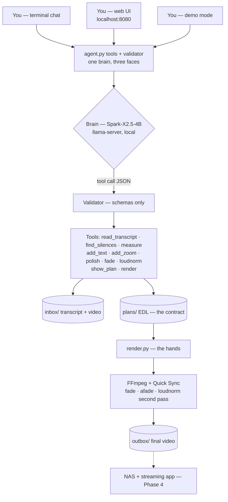

# Edit AI — how the system works (the schema)

> Read this top to bottom: the big picture, then the journey of one instruction,
> then the folder map. No jargon without explanation.

---

## 1. The big picture

Think of a **restaurant**: you talk to the *waiter*, the waiter writes an
*order ticket*, the *kitchen* cooks. You never enter the kitchen; the kitchen
never invents your order.

```
        YOU (the customer)
         │  "cut the silences, add a title"
         ▼
┌─────────────────────┐
│  agent.py  (waiter) │  terminal chat — the ONLY thing you touch
└─────────┬───────────┘
          │ passes your words to…
          ▼
┌─────────────────────┐
│   THE BRAIN         │  Qwen3-4B LLM, running locally (llama-server)
│   (understands      │  reads TEXT, chooses TOOLS, fills JSON.
│    and decides)     │  ⚠ it never touches video, never writes commands
└─────────┬───────────┘
          │ tool calls, e.g. add_text(start=0, end=3, text="Chapter 1")
          ▼
┌─────────────────────┐
│  THE VALIDATOR      │  a bouncer: checks every tool call
│  (Python)           │  unknown op? impossible time? → REJECTED
└─────────┬───────────┘
          │ only valid ops pass
          ▼
┌─────────────────────┐     ┌──────────────────────────────┐
│  THE PLAN (EDL)     │ ◄── │  THE SENSES  (measure.py)    │
│  a JSON edit list:  │     │  silences (audio)            │
│  keep 0→6, 9→13…    │     │  scene changes, brightness   │
│  + text/zoom/polish │     │  (no AI — pure ffmpeg math)  │
└─────────┬───────────┘     └──────────────────────────────┘
          │ plan approved? (you said "render")
          ▼
┌─────────────────────┐
│  THE HANDS          │  render.py — dumb executor, never thinks.
│  (FFmpeg)           │  renders each piece with Quick Sync,
│                     │  assembles → outbox/
└─────────┬───────────┘
          ▼
   outbox/test_clip_clean.mp4  ──►  (someday: NAS → streaming app)
```

**The three jobs, one line each:**
- the **brain** (LLM) understands and chooses tools
- the **validator + plan** (Python) guarantees honesty (deterministic math)
- the **hands** (FFmpeg) execute — the LLM never writes an FFmpeg command

---

## 2. The journey of one instruction

What happens, step by step, when you type
**"cut the silences over 2s, add a title 'Chapter 1' for 3s"**:

```
 ①  YOU type the sentence in the chat
        │
 ②  agent.py sends it to the BRAIN (local LLM)
        │    brain thinks: "I should call find_silences(min_gap=2)"
 ③  the TOOL CALL comes back as JSON  {tool: find_silences, min_gap: 2}
        │
 ④  the VALIDATOR checks it → OK, runs the real Python function
        │    which reads inbox/test_clip.transcript.json
 ⑤  the tool RESULT goes back to the brain  {[6→9], [13→16], [20→23]}
        │
 ⑥  brain makes the NEXT call: add_text(start=0, end=3, text="Chapter 1")
        │    validator checks: text short? times inside video? → OK
 ⑦  brain summarizes to you:  "3 cuts + 1 title. Say 'render' to proceed."
        │                      (the chat IS the review gate)
 ⑧  YOU say "render"
        │
 ⑨  render tool → writes plans/test_clip.edl.json → render.py
        │
 ⑩  FFmpeg cuts/encodes each segment (Quick Sync = the iGPU chip),
    concatenates, moves the finished file to outbox/
        │
 ⑪  brain reports: "Done — 15 seconds final video."
```

Loop between ② and ⑥ can repeat several times — the agent decides which
tools to call, in which order, until it can answer you.

---

## 3. The folder map (who writes where)

```
Edit AI/
│
├── inbox/            ← INPUT. You put things here.
│   ├── test_clip.mp4            the video (read-only for the system)
│   ├── test_clip.transcript.json   the "directing script" (timestamps)
│   └── job.json                 written by the agent at render time
│
├── plans/            ← MEMORY. the central artifact
│   ├── test_clip.edl.json        the edit plan (cuts + ops + approved?)
│   └── test_clip.measurements.json  what the senses measured
│
├── outbox/           ← OUTPUT. the only place render.py may write
│   └── (test_clip_clean.mp4)     deleted to save space; regenerate anytime
│
├── agent.py          the chat + tool registry + validator  (the waiter)
├── measure.py        the senses: silence/scene/brightness (the thermometer)
├── plan.py           transcript → edit plan (deterministic brain v1)
├── review.py         CLI approve/reject (the manual safety gate)
├── render.py         plan → FFmpeg renders (the kitchen)
│
├── models/           the BRAIN's weights (Qwen3-4B + granite fallback)
├── tools/llama-b10786/  llama.cpp: the program that RUNS the brain
└── lab/              your FFmpeg playground (Phase 0 demos)
```

**The safety invariant, drawn:** data flows left to right, one way:
`inbox → plans → outbox`. Nothing ever writes back into `inbox`
(except job.json, the agent's own handoff), and only render.py writes
to `outbox/`.

---

## 4. Where the intelligence lives (and doesn't)

```
  decisions that need JUDGMENT      decisions that need MATH
  ─────────────────────────         ─────────────────────────
  "which title text?"     →  LLM    gap > 2s → cut   →  Python
  "zoom here or there?"   →  LLM    timestamps valid? →  validator
  "is this plan good?"    →  YOU    encode/paste/join →  FFmpeg
                                     "is it silent?"  →  silencedetect
```

That's the whole trick: **the small local model is enough because it
only ever answers "what tool, which numbers" — never "how to edit
pixels".** The heavy lifting was solved in Phase 0–1; the brain just
directs traffic.

---

## 5. Same diagram, GitHub-flavored (renders as a real chart on GitHub)


